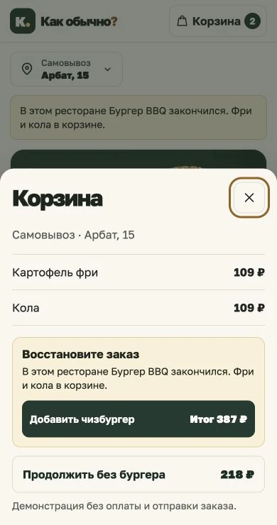
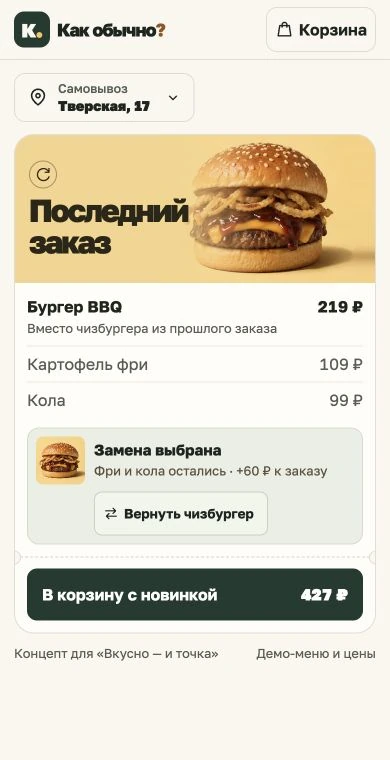

<a id="top"></a>

<picture>
  <source media="(prefers-color-scheme: dark)" srcset="docs/readme/hero-dark.webp">
  
</picture>

**Тестовое задание для VK · продуктовая аналитика**

Гость «Вкусно — и точка» повторяет знакомый заказ, но в выбранном ресторане одного блюда уже нет. **«Как обычно?»** показывает, что осталось в корзине, предлагает доступную замену и сразу показывает итоговую цену. Гость может восстановить заказ одним нажатием или продолжить с доступными блюдами.

**[Открыть сценарий восстановления ↗](https://worker4556.github.io/kak-obychno/?scenario=recovery)** · **[Обычный повтор ↗](https://worker4556.github.io/kak-obychno/)** · **[Разбор записи](docs/research.md#recording)** · **[План эксперимента](docs/research.md#experiment)**

<a id="problem"></a>

## Что показала запись приложения

В записи iOS от 24 ноября 2026 года гость открыл **«Профиль → Мои заказы»**, повторил один из заказов и отдельно перешёл в корзину. Приложение показало предупреждение: временно недоступная позиция называлась **«Неизвестный продукт»**. После закрытия предупреждения гость отдельно добавил чикенбургер из рекомендаций корзины и убрал гамбургер. Это одна наблюдаемая сессия. Она подтверждает ручной путь восстановления в этом примере.

**Предложение:** показать доступную замену в том же месте, где гость узнаёт о недоступности. В демо фри и кола остаются в корзине за **218 ₽**. Кнопка **«Добавить чизбургер · Итог 387 ₽»** сразу восстанавливает состав. Обычный повтор и добровольная замена доступны как соседние сценарии. [Разбор с таймкодами](docs/research.md#recording)

## Цифры из открытых источников

- **5,5 млн** активных пользователей приложения по итогам апреля 2026 года. [Релиз компании от 19 мая 2026 года](https://vkusnoitochka.ru/articles/news/new-loyalty-program)
- **Более 2,3 млн** гостей воспользовались новой программой лояльности с января к дате того же релиза. [Релиз компании от 19 мая 2026 года](https://vkusnoitochka.ru/articles/news/new-loyalty-program)
- **Более 240 новинок** сеть выпустила с запуска в 2022 году по 12 июня 2026 года. [Факты о компании](https://vkusnoitochka.ru/upload/files/more_facts.pdf)

Эти данные дают масштаб приложения и обновления меню. Для оценки сценария нужны внутренние данные по самовывозу: сколько гостей видят меню с прошлым заказом, как часто его повторяют и сколько из них доходят до корзины и оплаты.

<a id="interface"></a>

## Восстановление прямо в корзине

<a href="https://worker4556.github.io/kak-obychno/?scenario=recovery"></a>

### Когда оба бургера доступны

<p>
  <a href="docs/readme/repeat.webp"></a>
  <a href="docs/readme/swap.webp"></a>
</p>

Слева — повтор за **367 ₽**. Справа — тот же заказ с BBQ за **427 ₽**. Это два состояния одной карточки. Фотография и итог обновляются при выборе, а отмена доступна в карточке и корзине.

<a id="demo"></a>

## Проверить за минуту

1. [Откройте корзину с недоступной позицией](https://worker4556.github.io/kak-obychno/?scenario=recovery). Проверьте итог **218 ₽** и нажмите **«Добавить чизбургер · Итог 387 ₽»**.
2. В [обычном демо](https://worker4556.github.io/kak-obychno/) на **Тверской** нажмите «Заменить +60 ₽». Убедитесь, что изменилась только одна позиция. Для точного повтора нажмите «Вернуть чизбургер».
3. Добавьте заказ с BBQ в корзину и смените ресторан на **Арбат**. В этой точке BBQ закончился. Фри и кола сохранятся, их сумма **218 ₽**.
4. В корзине верните чизбургер и оформите демо-заказ. На **Бауманской** можно проверить пересчёт цен другой точки.

[Открыть демо ↗](https://worker4556.github.io/kak-obychno/)

<a id="measure"></a>

## Как примем решение

**Основной тест — восстановление заказа.** Среди гостей, у которых при повторе недоступно одно блюдо, сравним текущее предупреждение с предупреждением, где есть готовая замена. Метрика — доля гостей, восстановивших состав за 5 минут. Защитная метрика — оплата любого заказа за 30 минут. Быстрый вход в повтор и добровольную замену новинкой проверяем отдельно.

**Условный расчёт.** Чтобы заметить изменение с 30% до 32% при мощности 80% и двустороннем уровне значимости 5%, нужно **8 394 гостя на группу**. Для проверки оплаты при условной базе 20% и допустимой потере 1 п. п. нужно около **19 785 на группу**. Фактическую базу и размер сегмента берём из внутренней воронки. [События, SQL и расчёт →](docs/research.md#experiment)

<a id="start"></a>

## Запуск и структура

```sh
git clone https://github.com/worker4556/kak-obychno.git
cd kak-obychno
python3 -m http.server 8000
```

Откройте [localhost:8000](http://localhost:8000/).

- [`index.html`](index.html) — экран заказа и диалоги ресторана и корзины.
- [`style.css`](style.css) — общие стили компонентов и состояния на разных ширинах.
- [`app.js`](app.js) — общая модель состава и цены, действия и локальное сохранение корзины.
- [`docs/research.md`](docs/research.md) — источники, гипотезы, события и критерии решения.
- [`analysis/experiment_size.py`](analysis/experiment_size.py) — расчёт выборки.
- [`analysis/funnel.sql`](analysis/funnel.sql) — расчёт метрик по событиям, [проверенный на синтетических данных](analysis/verify_funnel.py).

Демо использует тестовые цены, меню и историю. Подтверждение заказа работает локально. На сборку, доработку и проверку прототипа ушло **около 30 минут**. ИИ помог собрать интерфейс, проверить сценарии и подготовить демонстрационные изображения. Шрифт Golos Text поставляется с [лицензией OFL](fonts/OFL.txt).

[К началу ↑](#top)
