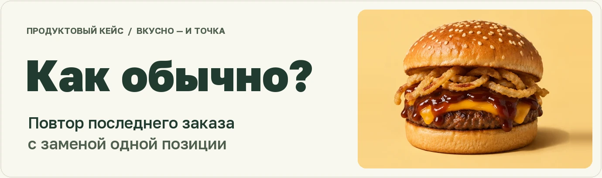
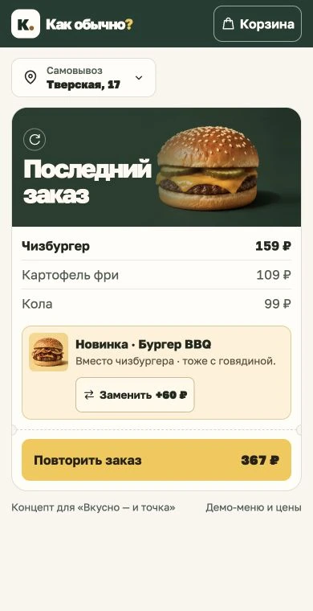

<a id="top"></a>

<picture>
  <source media="(prefers-color-scheme: dark)" srcset="docs/readme/hero-dark.webp">
  
</picture>

**«Как обычно?»** — прототип повторного заказа. Гость повторяет последний заказ одним нажатием или **меняет только бургер**, сохраняя фри и колу. Новый состав и итоговая цена видны прямо в карточке, ещё до корзины.

**[Открыть демо ↗](https://worker4556.github.io/kak-obychno/)** · **[Исследование](docs/research.md)** · **[Проверить за минуту](#demo)** · **[Запустить локально](#start)**

<a id="problem"></a>

## Почему этот сценарий

**Повтор заказа в приложении уже есть.** Вопрос в том, легко ли гостю заказать почти то же самое, когда он хочет поменять только одно блюдо. Команда приложения подтверждает быстрый повтор и описывает персональные рекомендации в акциях и корзине. В исследованиях Baymard участники находили прошлые покупки быстрее, когда видели их сразу, а крупная акция в Panera отвлекла от ссылки на повтор. [Ответ команды в App Store](https://apps.apple.com/kg/app/id896111038) · [Правила рекомендаций](https://vkusnoitochka.ru/recommendation-technologies) · [Исследование Baymard](https://baymard.com/research-articles/grocery-food-delivery-orders)

**Гипотеза.** Если вынести прошлый заказ в начало меню и разрешить точечную замену с пересчётом цены, больше возвращающихся гостей дойдут до заполненной корзины. Одну релевантную новинку можно проверить как отдельный способ повысить её покупку.

Точный путь замены в текущей авторизованной версии ещё предстоит проверить. В [исследовании](docs/research.md) описано, как это сделать и при каких результатах стоит сузить задачу.

<a id="interface"></a>

## Один заказ, два варианта

<p>
  <a href="docs/readme/repeat.webp"></a>
  <a href="docs/readme/swap.webp"></a>
</p>

Слева — повтор за **367 ₽**. Справа — тот же заказ с BBQ за **427 ₽**. Это два состояния одной карточки. Фотография и итог обновляются при выборе, а отмена доступна в карточке и корзине.

<a id="demo"></a>

## Проверить за минуту

1. На **Тверской** нажмите «Заменить +60 ₽». Убедитесь, что изменилась только одна позиция. Для точного повтора нажмите «Вернуть чизбургер».
2. Добавьте заказ с BBQ в корзину и смените ресторан на **Арбат**. В этой точке BBQ закончился. Фри и кола сохранятся, их сумма **218 ₽**.
3. В корзине верните чизбургер и оформите демо-заказ. На **Бауманской** можно проверить пересчёт цен другой точки.

[Открыть демо ↗](https://worker4556.github.io/kak-obychno/)

<a id="measure"></a>

## Что измерим

- **Быстрый повтор:** текущий путь против карточки. Главная метрика — доля подходящих сессий, дошедших от меню до заполненной корзины. Время до корзины помогает понять, ускорился ли путь.
- **Замена:** карточка с предложением против карточки без него. Измеряем долю подходящих гостей, оплативших заказ с целевой новинкой, и контролируем общую конверсию в оплату.

[Наблюдения, примеры других приложений и план эксперимента →](docs/research.md)

<a id="start"></a>

## Запуск и структура

```sh
git clone https://github.com/worker4556/kak-obychno.git
cd kak-obychno
python3 -m http.server 8000
```

Откройте [localhost:8000](http://localhost:8000/).

- [`index.html`](index.html) — экран заказа и диалоги ресторана и корзины.
- [`style.css`](style.css) — общие стили компонентов и состояния на разных ширинах.
- [`app.js`](app.js) — общая модель состава и цены, действия и локальное сохранение корзины.
- [`docs/research.md`](docs/research.md) — кабинетное исследование, ограничения и план проверки.

Демо использует тестовые цены, меню и историю. Подтверждение заказа работает локально. На сборку, доработку и публикацию прототипа ушло **около 15–20 минут**. Фотографии сделаны с помощью ImageGen, шрифт Golos Text поставляется с [лицензией OFL](fonts/OFL.txt).

[К началу ↑](#top)
